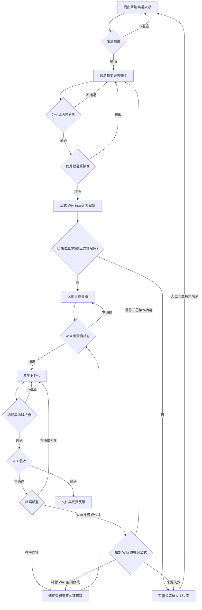

# Fourier Transform Wiki → HTML Graph / Loop

## Graph

## Loop
每個自動修正節點最多 3 輪；只修檢查指出的問題。遇到來源不足、無法判定公式慣例、或 3 輪仍未通過時，停止並記錄，等待使用者決策。人工核准須明確取得。Wiki 覆蓋率不足時，先暫停，等使用者同意補充來源才返回候選來源。驗收若發現 Wiki 來源或公式問題，先核對證據。若需修正已核准內容，退回該篇摘要與證據卡，經公式與內容核對及人工重新核准後更新 Wiki。若發現來源失效，依來源驗證的退回路線處理，替代來源仍須逐篇核准。Wiki 證據確認無須修改時，修正受影響的逐頁稿並重做忠實度檢查。每次修正後均須再經相關檢查與最終人工驗收。

## 預計檢查
- 來源：網址有效、來源資訊可辨識、沒有重複計數。
- Wiki：核准篇數 >= 5、概念覆蓋、公式慣例一致、來源對照可追溯。
- 逐頁稿：重要主張可對照 Wiki，公式、符號與例題一致。
- HTML：10–12 頁、可開啟、可切換、互動圖表運作、無文字溢出。
- 人工：逐篇 ingest 核准、最後簡報驗收。

**目前狀態：設計完成，尚未實際執行任何資料或 HTML 檢查。**
